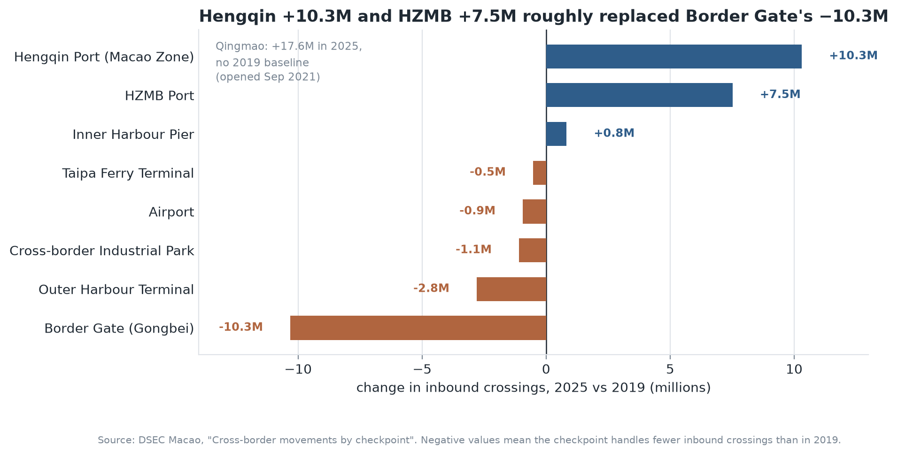

# Chen Binmo (陈宾墨)

**Data analysis and visualisation · Macao**

I am a student in Macao working at the intersection of statistics and visual communication. Most of my
work starts with the same question: *what does a number hide?* A headline total, a year-on-year change
or a "recovery" usually contains a structural story underneath it, and my interest is in building the
chart that makes that structure visible rather than the one that merely restates the total.

This portfolio collects my analysis projects. Each one ships with the notebook, the data, the
figures and a written account of the decisions behind them — including the ones that did not work.

---

## Technical skills

| Area | Tools |
|---|---|
| **Languages** | Python, SQL (learning), Markdown |
| **Data handling** | pandas, NumPy, openpyxl — cleaning, reshaping, joining, schema repair |
| **Visualisation** | Matplotlib, Plotly, Dash; static design for print and web |
| **Analysis** | Exploratory data analysis, time-series comparison, index and share decomposition |
| **Workflow** | Jupyter, Git / GitHub, GitHub Pages, reproducible environments (`requirements.txt`) |

---

## Project showcase

### Has Macao's border reopened — or been rebuilt?

**Research question.** Macao recorded 117.9 million inbound border crossings in 2025 — more than in any
pre-pandemic year. Did the cross-border system return to its 2019 shape, or did the pandemic
permanently reallocate traffic between checkpoints and between types of traveller?

**What the data showed.** The record is real, but it is not the old record. Macao residents' crossings
grew 41 % against 2019 while visitor crossings grew 12 %, so a larger share of the traffic is now local
mobility rather than tourism. Underneath that, the gateway map was redrawn: Border Gate fell from 74.4 %
to 52.7 % of inbound crossings, while Hengqin Port (+10.3 M), the HZMB Port (+7.5 M) and the new
Qingmao crossing (+17.6 M, opened 2021) took the difference. Every air and sea gateway is still below
2019 — the Outer Harbour ferry terminal is at 36 % of its pre-pandemic volume, Taipa at 82 % — so the
recovery is land-based.

| | |
|---|---|
| **Data** | Statistics and Census Service (DSEC) of Macao, via the Macao Open Data Platform — fully open licence, 2018–2025 |
| **Methods** | pandas cleaning of a mid-series schema change, checkpoint name harmonisation, cross-table validation, five Matplotlib figures |
| **Repository** | [github.com/cinky8848/data-science-project](https://github.com/cinky8848/data-science-project) |
| **Status** | **Completed** (analysis and write-up); extending to monthly data next |

**A limitation I want to be explicit about.** The dataset counts movements, not people. A daily commuter
contributes hundreds of crossings and a three-night tourist contributes two, so the growth in the
resident share cannot be read as "more people crossing more often". Without monthly data or a
purpose-of-travel field, the reallocation between checkpoints can be measured but not explained.

---

## Currently

- Extending the Macao project to **monthly** series so the 2020–2023 phase can be dated precisely.
- Learning **SQL** and dashboard deployment (Dash) to put these analyses behind an interface.

## Contact

- GitHub: [@cinky8848](https://github.com/cinky8848)
- Email: *(add your email here if you want it public)*
